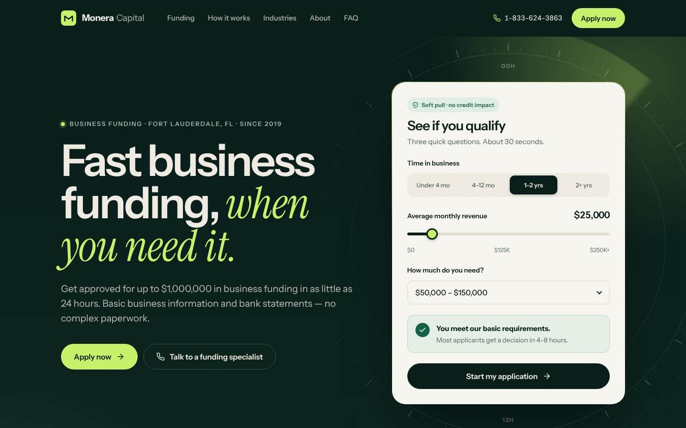

# Monera Capital — spec redesign

A speculative redesign of [moneracapital.com](https://moneracapital.com) for Zain Razvi, Co-Founder & CEO of Monera Capital. It keeps Monera's existing copy and gives it a new design: forest ink, warm paper and one signal colour, set in Instrument Sans with Instrument Serif accents.



Static HTML, CSS and JS. No build step, no dependencies apart from Google Fonts.

## Preview locally

```bash
cd ~/dev/monera-capital-spec && python3 -m http.server 8080
# open http://localhost:8080
```

## Deploy

Import this repo in Vercel (Framework preset: **Other**, no build command, output directory: root). Every push to `main` redeploys.

Or from the CLI:

```bash
cd ~/dev/monera-capital-spec && npx vercel --prod
```

The page ships with `<meta name="robots" content="noindex, nofollow">`, and `vercel.json` adds an `X-Robots-Tag: noindex` header, because it uses Monera's real name and branding. Remove both only if Monera signs and the site goes live.

## What's on the page

- Hero with a "See if you qualify" card that checks visitors against Monera's published minimums, over a 24-hour dial with a slow sweep.
- Proof stats that count up: $43M+ deployed, 1,000+ businesses, $10M in the first 18 months, 4–8 hour decisions.
- Two featured products (Working Capital, Revenue-Based Financing) and a numbered ledger of the other six, with partner-provided products tagged "Via partner".
- A funding timeline (0h, 4–8h, 24–48h) that draws itself on scroll, plus a "What you'll need" checklist.
- Industries marquee, mission quote, growth track, Zain's bio, a seven-question FAQ, and the partner disclosure in the footer.

## Verify before pitching

The copy was gathered from Monera's live site through a search index, so check it against the site:

- **Eligibility minimums disagree across Monera's pages.** The FAQ says 1 year and $10K/month, the funding page says 6 months, and the revenue-based financing page says 4 months and $7,500/month. The spec uses 1 year / $10K for most products and 4 months / $7.5K for revenue-based financing.
- **Speed claims vary.** The spec uses "decision in 4–8 hours, funded in 24–48 hours"; the business-loans page says 24–48 hour approval.
- **Two addresses appear.** The spec uses 1560 Sawgrass Corporate Pkwy; the partners page lists 10171 NW 53rd St.
- **The email domain differs from the website.** The email is `info@moneracapitalgroup.com` while the site is `moneracapital.com`.
- **Some product one-liners are new**, and "Most requested" on Working Capital is a design label, not a Monera claim.
- **Placeholder:** a "ZR" monogram stands in for Zain's headshot.
